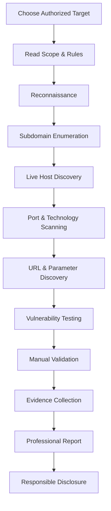

# Bug-Hunting-Blueprint

Beginner to Professional | Ethical Hacking | Web Bug Bounty | Kali Linux

Bug Hunting হলো কোনো ওয়েবসাইট, ওয়েব অ্যাপ্লিকেশন বা API-তে নিরাপত্তাজনিত দুর্বলতা খুঁজে বের করা, যাচাই করা এবং দায়িত্বশীলভাবে রিপোর্ট করার প্রক্রিয়া।

আপনার লক্ষ্য হবে একজন Professional Bug Bounty Hunter হিসেবে দক্ষতা অর্জন করা।

### 1\. Complete learning roadmap

* Foundation – Basic Knowledge

    * Networking: TCP/IP, DNS, HTTP/HTTPS

    * Linux command line

    * HTML, CSS, JavaScript

    * Python and Bash scripting

    * Web architecture

* Reconnaissance – Target Discovery

    * Domain enumeration

    * Subdomain discovery

    * DNS enumeration

    * Port scanning

    * Technology fingerprinting

    * JavaScript file discovery

* Vulnerability Hunting

    * XSS

    * SQL Injection

    * IDOR / BOLA

    * CSRF

    * SSRF

    * XXE

    * Authentication flaws

    * Access control vulnerabilities

* Automation

    * Bash scripting

    * Python automation

    * Nuclei

    * HTTPX

    * Nmap

    * GAU

    * Wayback URLs

    * GF patterns

* Validation & Exploitation

    * Confirm vulnerabilities

    * Reproduce security issues

    * Assess impact

    * Avoid destructive testing

    * Capture evidence

* Reporting & Rewards

    * Write professional reports

    * Explain impact

    * Provide reproduction steps

    * Submit through authorized platforms

    * Follow responsible disclosure

### 2\. Bug hunting workflow

### 3\. Essential Kali Linux tools

| Category               | Tools               |
| ---------------------- | ------------------- |
| Recon                  | Subfinder, Amass    |
| HTTP probing           | HTTPX               |
| Port scanning          | Nmap                |
| Web discovery          | Katana, GAU         |
| Vulnerability scanning | Nuclei              |
| Web testing            | Burp Suite          |
| URL analysis           | GF, URO             |
| JavaScript analysis    | LinkFinder          |
| Automation             | Python, Bash        |
| Reporting              | Markdown, HTML, CSV |

![\[Security Series\] Website Vulnerability Testing using OWASP ZAP | by Rahmat Wibowo | Medium](https://images.openai.com/static-rsc-4/H_qnlKPUQkrs5J6n0RGG8Dg3qh2t5kdzmSFPqL63m6EblmE2BTjgoQAs8WzYCSV2gSK_uiy2L7hadsGK-CIfJMwV3_-6mHZLthxZ8iybGW3IG62YaXT6Q85nnJnhSlqtbju77A6mETmb0uqOXUYugFrp1XC0qxSgbpRuVw4RRuCFjtqqcUJxQ_CPRAfGbNuc?purpose=fullsize)

![\[VulnHub\] Basic Pentesting 1 Walkthrough](https://images.openai.com/static-rsc-4/qAEVKBAoNGWzMtTK-bjgl9h-22Xsp6AFcSIJP051H4uRFfhyN6Odulz0YXI2dhmhoLTb3cS4w63z4YAv1ecWiYc5HW6BVNXZuxbo9sdvDsNF6ctpMm0skhIiWyQpPGZYg7dYCASgIdBebTRdZTBnEoWmTkET3HypM58fcbna1vH1yQYhyEkTvT9fccorWlaZ?purpose=fullsize)

### 4\. Vulnerabilities you should master

| Vulnerability                | Priority |
| ---------------------------- | -------- |
| Broken Access Control / IDOR | High     |
| Cross-Site Scripting (XSS)   | High     |
| SQL Injection                | High     |
| Authentication Bypass        | High     |
| Server-Side Request Forgery  | High     |
| Business Logic Flaws         | High     |
| CSRF                         | Medium   |
| Security Misconfiguration    | Medium   |
| Information Disclosure       | Medium   |

### 5\. Recommended learning resources

PortSwigger Web Security Academy

Free practical web security labs.

[Start learning](https://portswigger.net/web-security?utm_source=chatgpt.com)

OWASP

Web application security testing guide.

[Explore WSTG](https://owasp.org/www-project-web-security-testing-guide/?utm_source=chatgpt.com)

HackerOne

Authorized bug bounty programs.

[Explore programs](https://www.hackerone.com/?utm_source=chatgpt.com)

Bugcrowd

Vulnerability disclosure and bounty programs.

[Explore programs](https://www.bugcrowd.com/?utm_source=chatgpt.com)

### 6\. Your 90-day training plan

Month 1: Foundation

Days 1–30

* Linux and networking

* HTTP requests and responses

* HTML, JavaScript basics

* Burp Suite fundamentals

Month 2: Practical Hunting

Days 31–60

* Recon automation

* Subdomain enumeration

* XSS, IDOR, SQLi labs

* API security testing

Month 3: Professional Workflow

Days 61–90

* Real authorized bug bounty programs

* Manual vulnerability validation

* Evidence collection

* Professional report writing

### 7\. Let's configure your personal bug hunting blueprint

আপনার Kali Linux ও ওয়েবসাইট Bug Bounty শেখার আগ্রহ অনুযায়ী নিচের বিষয়গুলো নির্ধারণ করলে আমি আপনার জন্য বাস্তবসম্মত কমান্ড, Bash/Python automation, রিপোর্টিং সিস্টেমসহ পূর্ণাঙ্গ পরিকল্পনা সাজাতে পারব।

1\. আপনার বর্তমান দক্ষতা

Beginner – একদম নতুন

Intermediate – কিছু অভিজ্ঞতা আছে

Advanced – বাস্তবে Bug Hunting করি

2\. কোন ধরনের Target নিয়ে কাজ করবেন?

Websites

APIs

Mobile Applications

All

3\. Hunting Method

Manual Testing

Automation

Manual + Automation

4\. আপনার প্রধান লক্ষ্য

Ethical Hacking শেখা

Bug Bounty থেকে আয় করা

Professional Pentester হওয়া

নিজস্ব Automation Framework তৈরি

5\. Operating System

Kali Linux

Windows + Kali Linux VM

Other Linux

Generate My Bug Hunting Blueprint

নিরাপত্তা নোট: শুধু নিজের সিস্টেম, অনুমোদিত ল্যাব অথবা লিখিত অনুমতি ও নির্দিষ্ট Scope থাকা Bug Bounty Target-এ পরীক্ষা করবেন।
