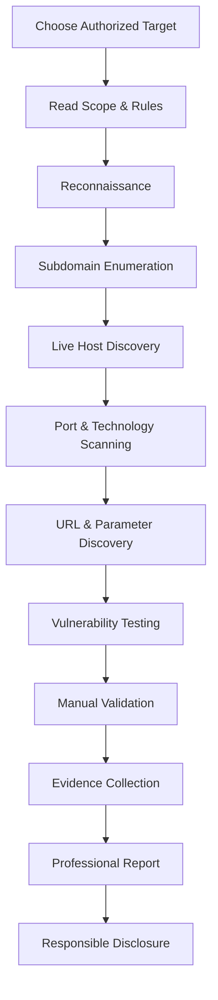

# Bug-Hunting-Blueprint

Beginner to Professional | Ethical Hacking | Web Bug Bounty | Kali Linux

Bug Hunting হলো কোনো ওয়েবসাইট, ওয়েব অ্যাপ্লিকেশন বা API-তে নিরাপত্তাজনিত দুর্বলতা খুঁজে বের করা, যাচাই করা এবং দায়িত্বশীলভাবে রিপোর্ট করার প্রক্রিয়া।

আপনার লক্ষ্য হবে একজন Professional Bug Bounty Hunter হিসেবে দক্ষতা অর্জন করা।


### 1\. Complete learning roadmap

* Foundation – Basic Knowledge

    * Networking: TCP/IP, DNS, HTTP/HTTPS

    * Linux command line

    * HTML, CSS, JavaScript

    * Python and Bash scripting

    * Web architecture

* Reconnaissance – Target Discovery

    * Domain enumeration

    * Subdomain discovery

    * DNS enumeration

    * Port scanning

    * Technology fingerprinting

    * JavaScript file discovery

* Vulnerability Hunting

    * XSS

    * SQL Injection

    * IDOR / BOLA

    * CSRF

    * SSRF

    * XXE

    * Authentication flaws

    * Access control vulnerabilities

* Automation

    * Bash scripting

    * Python automation

    * Nuclei

    * HTTPX

    * Nmap

    * GAU

    * Wayback URLs

    * GF patterns

* Validation & Exploitation

    * Confirm vulnerabilities

    * Reproduce security issues

    * Assess impact

    * Avoid destructive testing

    * Capture evidence

* Reporting & Rewards

    * Write professional reports

    * Explain impact

    * Provide reproduction steps

    * Submit through authorized platforms

    * Follow responsible disclosure

### 2\. Bug hunting workflow




### 3\. Essential Kali Linux tools

| Category               | Tools               |
| ---------------------- | ------------------- |
| Recon                  | Subfinder, Amass    |
| HTTP probing           | HTTPX               |
| Port scanning          | Nmap                |
| Web discovery          | Katana, GAU         |
| Vulnerability scanning | Nuclei              |
| Web testing            | Burp Suite          |
| URL analysis           | GF, URO             |
| JavaScript analysis    | LinkFinder          |
| Automation             | Python, Bash        |
| Reporting              | Markdown, HTML, CSV |


![\[Security Series\] Website Vulnerability Testing using OWASP ZAP | by Rahmat Wibowo | Medium](https://images.openai.com/static-rsc-4/H_qnlKPUQkrs5J6n0RGG8Dg3qh2t5kdzmSFPqL63m6EblmE2BTjgoQAs8WzYCSV2gSK_uiy2L7hadsGK-CIfJMwV3_-6mHZLthxZ8iybGW3IG62YaXT6Q85nnJnhSlqtbju77A6mETmb0uqOXUYugFrp1XC0qxSgbpRuVw4RRuCFjtqqcUJxQ_CPRAfGbNuc?purpose=fullsize)


![\[VulnHub\] Basic Pentesting 1 Walkthrough](https://images.openai.com/static-rsc-4/qAEVKBAoNGWzMtTK-bjgl9h-22Xsp6AFcSIJP051H4uRFfhyN6Odulz0YXI2dhmhoLTb3cS4w63z4YAv1ecWiYc5HW6BVNXZuxbo9sdvDsNF6ctpMm0skhIiWyQpPGZYg7dYCASgIdBebTRdZTBnEoWmTkET3HypM58fcbna1vH1yQYhyEkTvT9fccorWlaZ?purpose=fullsize)


### 4\. Vulnerabilities you should master

| Vulnerability                | Priority |
| ---------------------------- | -------- |
| Broken Access Control / IDOR | High     |
| Cross-Site Scripting (XSS)   | High     |
| SQL Injection                | High     |
| Authentication Bypass        | High     |
| Server-Side Request Forgery  | High     |
| Business Logic Flaws         | High     |
| CSRF                         | Medium   |
| Security Misconfiguration    | Medium   |
| Information Disclosure       | Medium   |

### 5\. Recommended learning resources


PortSwigger Web Security Academy

Free practical web security labs.

[Start learning](https://portswigger.net/web-security?utm_source=chatgpt.com)


OWASP

Web application security testing guide.

[Explore WSTG](https://owasp.org/www-project-web-security-testing-guide/?utm_source=chatgpt.com)


HackerOne

Authorized bug bounty programs.

[Explore programs](https://www.hackerone.com/?utm_source=chatgpt.com)


Bugcrowd

Vulnerability disclosure and bounty programs.

[Explore programs](https://www.bugcrowd.com/?utm_source=chatgpt.com)

### 6\. Your 90-day training plan

Month 1: Foundation

Days 1–30

* Linux and networking

* HTTP requests and responses

* HTML, JavaScript basics

* Burp Suite fundamentals

Month 2: Practical Hunting

Days 31–60

* Recon automation

* Subdomain enumeration

* XSS, IDOR, SQLi labs

* API security testing

Month 3: Professional Workflow

Days 61–90

* Real authorized bug bounty programs

* Manual vulnerability validation

* Evidence collection

* Professional report writing

### 7\. Let's configure your personal bug hunting blueprint

আপনার Kali Linux ও ওয়েবসাইট Bug Bounty শেখার আগ্রহ অনুযায়ী নিচের বিষয়গুলো নির্ধারণ করলে আমি আপনার জন্য বাস্তবসম্মত কমান্ড, Bash/Python automation, রিপোর্টিং সিস্টেমসহ পূর্ণাঙ্গ পরিকল্পনা সাজাতে পারব।

1\. আপনার বর্তমান দক্ষতা

Beginner – একদম নতুন

Intermediate – কিছু অভিজ্ঞতা আছে

Advanced – বাস্তবে Bug Hunting করি

2\. কোন ধরনের Target নিয়ে কাজ করবেন?

Websites

APIs

Mobile Applications

All

3\. Hunting Method

Manual Testing

Automation

Manual + Automation

4\. আপনার প্রধান লক্ষ্য

Ethical Hacking শেখা

Bug Bounty থেকে আয় করা

Professional Pentester হওয়া

নিজস্ব Automation Framework তৈরি

5\. Operating System

Kali Linux

Windows + Kali Linux VM

Other Linux

Generate My Bug Hunting Blueprint

নিরাপত্তা নোট: শুধু নিজের সিস্টেম, অনুমোদিত ল্যাব অথবা লিখিত অনুমতি ও নির্দিষ্ট Scope থাকা Bug Bounty Target-এ পরীক্ষা করবেন।
Worked for 43s

### 🛡️ আপনার Personal Bug Hunting Blueprint

Platform: Kali Linux | Target: Websites | Method: Manual + Automation | Goal: Bug Bounty Rewards

আপনার জন্য এমন একটি Bug Hunting Workflow তৈরি করছি, যেখানে আপনি প্রথমে ওয়েবসাইটের নিরাপত্তা বুঝবেন, তারপর Reconnaissance করবেন, স্বয়ংক্রিয়ভাবে সম্ভাব্য দুর্বলতা খুঁজবেন, হাতে পরীক্ষা করে নিশ্চিত করবেন এবং শেষে Professional Vulnerability Report জমা দেবেন।

মূল নীতি: Automation দিয়ে সম্ভাব্য সমস্যা খুঁজবেন, কিন্তু Manual Testing দিয়ে Vulnerability নিশ্চিত করবেন। শুধু Scanner-এর ফলাফলকে কখনো Confirmed Bug হিসেবে রিপোর্ট করবেন না।


### 1\. আপনার Bug Hunting Architecture

### Bug Hunting Pipeline

01\. Authorized Target

Scope, exclusions, rules, rate limits

02\. Reconnaissance

Subdomains, DNS, technologies, ports

03\. Attack Surface Mapping

URLs, parameters, JavaScript, APIs

04\. Vulnerability Testing

XSS, IDOR, SQLi, SSRF, access control

05\. Manual Validation

Reproduction, impact, evidence

06\. Professional Reporting

Submit, communicate, responsible disclosure

### 2\. Kali Linux: Required Tools

প্রথমে এই টুলগুলো শিখবেন।

| Tool       | কাজ                                    |
| ---------- | -------------------------------------- |
| Nmap       | Port scanning                          |
| Subfinder  | Subdomain discovery                    |
| HTTPX      | Live host detection                    |
| Katana     | Web crawling                           |
| GAU        | Historical URL collection              |
| Nuclei     | Template-based vulnerability detection |
| Burp Suite | Manual web testing                     |
| GF         | URL pattern filtering                  |
| Python     | Automation                             |


### 3\. Kali Linux environment setup

### Step 1: Update Kali

```bash
sudo apt update
sudo apt full-upgrade -y

sudo apt install -y \
  git curl wget jq unzip \
  python3 python3-venv python3-pip \
  golang-go nmap dnsutils \
  whois seclists
```

Check your environment:

```bash
uname -a
python3 --version
go version
nmap --version
```

### Step 2: Install ProjectDiscovery tools

আপনার Recon automation-এর জন্য ProjectDiscovery toolchain ব্যবহার করব।

প্রথমে Go compatibility পরীক্ষা করুন:

```bash
go version
go env GOPATH
```

ProjectDiscovery-এর `pdtm` দিয়ে একসঙ্গে প্রয়োজনীয় টুল ইনস্টল করা যায়।

```bash
go install -v github.com/projectdiscovery/pdtm/cmd/pdtm@latest
```

PATH configure করুন:

```bash
echo 'export PATH="$PATH:$HOME/go/bin"' >> ~/.zshrc
source ~/.zshrc
```

তারপর:

```bash
pdtm -install-all
```

Verify:

```bash
subfinder -version
httpx -version
katana -version
nuclei -version
```

সতর্কতা: ProjectDiscovery-এর নতুন release-এর Go requirement পরিবর্তিত হয়। পুরোনো Go version দিয়ে latest release install ব্যর্থ হলে আগে official installation requirement মিলিয়ে নেবেন। Kali-তে Python package-এর জন্য system-wide pip installation এড়িয়ে চলুন; প্রয়োজনে virtual environment ব্যবহার করুন। ProjectDiscovery +3

### Step 3: Install Burp Suite

```bash
sudo apt install -y burpsuite
```

যদি Kali repository-তে package না থাকে, [Burp Suite Community Edition](https://portswigger.net/burp/communitydownload?utm_source=chatgpt.com) থেকে official installer ব্যবহার করুন।

Burp Suite-এ:

* Proxy → Proxy settings খুলুন।

* Browser-এর proxy configuration করুন।

* Intercept চালু করুন।

* নিজের lab website খুলুন।

* HTTP request এবং response পর্যবেক্ষণ করুন।


### 4\. Project directory structure

প্রতিটি Bug Bounty target-এর জন্য আলাদা directory রাখবেন।

```bash
mkdir -p ~/BugBounty/{targets,projects,tools,reports}
cd ~/BugBounty

mkdir -p projects/target01/{recon,urls,scans,evidence,reports}
```

আপনার directory structure হবে:

```text
BugBounty/
│
├── targets/
│   └── scope.txt
│
├── projects/
│   └── target01/
│       ├── recon/
│       ├── urls/
│       ├── scans/
│       ├── evidence/
│       └── reports/
│
├── tools/
└── reports/
```

### Step 5: Scope file তৈরি করুন

```bash
nano ~/BugBounty/targets/scope.txt
```

এখানে শুধু অনুমোদিত target URL লিখুন।

```text
https://example.com
https://api.example.com
```

`example.com` এখানে শুধু উদাহরণ। বাস্তব bug bounty program-এর অনুমোদিত target ব্যবহার করবেন।

Scope rules:

* In-scope এবং out-of-scope আলাদা রাখবেন।

* শুধু অনুমোদিত host পরীক্ষা করবেন।

* Wildcard scope থাকলেও প্রতিটি discovered subdomain স্বয়ংক্রিয়ভাবে অনুমোদিত ধরে নেবেন না।

* Rate limit ও নিষিদ্ধ testing technique মেনে চলবেন।

### 5\. Reconnaissance – Practical CLI Commands

Passive Recon থেকে শুরু করুন।

### A. Subdomain enumeration

```bash
subfinder -d example.com -silent \
-o subdomains.txt
```

### B. Live host detection

```bash
httpx -l subdomains.txt \
-title -status-code -tech-detect \
-silent -o live_hosts.txt
```

### C. DNS information

```bash
dig example.com A
dig example.com MX
dig example.com NS
```

### D. Port scanning

শুধু স্পষ্টভাবে অনুমোদিত IP বা host-এর ক্ষেত্রে:

```bash
nmap -sT -sV --top-ports 100 \
--max-rate 10 TARGET_IP \
-oN nmap_report.txt
```

### E. URL discovery

```bash
katana -u https://example.com \
-d 2 -jc -silent \
-o katana_urls.txt
```

Historical URL:

```bash
gau example.com \
--threads 2 \
-o historical_urls.txt
```

সব URL একত্র করুন:

```bash
cat katana_urls.txt historical_urls.txt \
| sort -u > all_urls.txt
```

### F. Parameter filtering

```bash
grep -E '\?.+=' all_urls.txt \
> parameter_urls.txt
```

এখানে আপনি `id`, `redirect`, `url`, `file`, `search`, `page` ইত্যাদি parameter আলাদাভাবে বিশ্লেষণ করতে পারবেন।

উপরের subdomain discovery command সম্ভাব্য asset বের করে; তার ফলাফল সরাসরি scan করবেন না। প্রথমে প্রতিটি host-এর অনুমোদিত scope যাচাই করুন। ProjectDiscovery +2

### 6\. Automated Bug Hunting Script

এবার আপনার জন্য একটি Bash automation script দিচ্ছি।

এর কাজ:

* Approved target list পড়বে।

* Live HTTP hosts খুঁজবে।

* Web crawling করবে।

* URL সংগ্রহ করবে।

* Low-impact Nuclei checks চালাবে (আপনি অনুমতি দিলে)।

* Results আলাদা ফাইলে সংরক্ষণ করবে।

File: bughunt.sh

```bash

#!/usr/bin/env bash

set -Eeuo pipefail

# Usage:
# ./bughunt.sh scope.txt project_name
#
# Optional:
# RUN_NUCLEI=1 ./bughunt.sh scope.txt project_name

SCOPE="${1:-}"
PROJECT="${2:-target01}"
RUN_NUCLEI="${RUN_NUCLEI:-0}"

if [[ -z "$SCOPE" || ! -f "$SCOPE" ]]; then
    echo "Usage: $0 scope.txt project_name"
    exit 1
fi

for tool in httpx katana; do
    command -v "$tool" >/dev/null || {
        echo "Missing tool: $tool"
        exit 1
    }
done

OUT="$HOME/BugBounty/projects/$PROJECT"

mkdir -p "$OUT"/{recon,urls,scans,evidence,reports}

# Keep only URLs, remove blank/comment lines.
grep -E '^https?://' "$SCOPE" |
sort -u > "$OUT/recon/approved_scope.txt"

if [[ ! -s "$OUT/recon/approved_scope.txt" ]]; then
    echo "No approved URLs found."
    exit 1
fi

echo "[1] Checking live hosts..."

httpx \
    -l "$OUT/recon/approved_scope.txt" \
    -silent \
    -rl 2 \
    -o "$OUT/recon/live_hosts.txt"

echo "[2] Crawling approved live hosts..."

while IFS= read -r url; do
    [[ -z "$url" ]] && continue

    safe_name=$(printf '%s' "$url" |
        sed 's|https\?://||; s|[^a-zA-Z0-9_-]|_|g')

    katana \
        -u "$url" \
        -d 2 \
        -c 2 \
        -rl 2 \
        -silent \
        -o "$OUT/urls/$safe_name.txt" \
        || echo "Crawl issue: $url"

done < "$OUT/recon/live_hosts.txt"

cat "$OUT"/urls/*.txt 2>/dev/null |
    sort -u > "$OUT/urls/all_urls.txt" || true

echo "[3] Optional Nuclei checks..."

if [[ "$RUN_NUCLEI" == "1" ]] &&
   command -v nuclei >/dev/null; then

    nuclei \
        -l "$OUT/recon/live_hosts.txt" \
        -tags misconfig \
        -severity info,low,medium \
        -rl 2 \
        -c 2 \
        -jsonl \
        -o "$OUT/scans/nuclei.jsonl"

else
    echo "Nuclei skipped. Set RUN_NUCLEI=1 to enable."
fi

echo "[4] Completed."

echo "Results saved at: $OUT"
```

### Run the script

```bash
chmod +x bughunt.sh

./bughunt.sh \
~/BugBounty/targets/scope.txt \
target01
```

Optional Nuclei execution:

```bash
RUN_NUCLEI=1 ./bughunt.sh \
~/BugBounty/targets/scope.txt \
target01
```

Automation ready

এই starter script-এ aggressive scanning, brute force, fuzzing বা destructive testing নেই। Nuclei-এর `misconfig` tag-ও সবসময় harmless নয়; প্রতিটি template যাচাই করে program-এর অনুমতি ও rate limit অনুযায়ী ব্যবহার করবেন। Scanner-এর ফলাফল manual verification ছাড়া report করবেন না।

### 7\. Manual Vulnerability Hunting

এখানে আপনার সবচেয়ে বেশি সময় দেওয়া উচিত।

প্রথমে এই ছয়টি Vulnerability শিখুন।

### 1\. IDOR – Insecure Direct Object Reference


উদাহরণ:

```text
https://lab.example/profile?id=1001
```

নিজের অনুমোদিত Lab-এ পরীক্ষা করুন:

* User A কি শুধু নিজের তথ্য দেখতে পারে?

* User B কি শুধু নিজের তথ্য দেখতে পারে?

* User A কি User B-এর তথ্য দেখতে পারছে?

* Server কি প্রতিটি request-এ authorization যাচাই করছে?

মূল বিষয়: শুধু ID পরিবর্তন করলেই IDOR প্রমাণ হয় না। অন্য ব্যবহারকারীর তথ্য অনুমতি ছাড়া পাওয়া যাচ্ছে কি না তা যাচাই করতে হবে।

### 2\. Cross-Site Scripting (XSS)


পরীক্ষার জায়গা:

* Search box

* URL parameters

* Comment section

* Profile fields

* Input forms

নিজের lab-এ harmless HTML test:

```html
<b>Security-Test</b>
```

দেখুন input-টি HTML হিসেবে render হচ্ছে নাকি plain text হিসেবে।

পরবর্তীতে PortSwigger-এর XSS labs-এ JavaScript execution ও context analysis শিখবেন।

### 3\. SQL Injection


পরীক্ষার জায়গা:

* Login forms

* Search parameters

* Product IDs

* Database-driven endpoints

প্রথমে বুঝবেন:

* SQL query কীভাবে তৈরি হয়?

* Parameterized query কী?

* Error-based এবং blind SQLi কী?

* False positive কীভাবে বাদ দিতে হয়?

শুধু অনুমোদিত lab-এ SQLi payload পরীক্ষা করবেন। বাস্তব ওয়েবসাইটে database extraction করবেন না।

### 4\. Authentication Vulnerabilities

পরীক্ষা করুন:

* Password reset logic

* Session expiration

* Logout behavior

* MFA implementation

* Account recovery

* Session fixation

### 5\. Broken Access Control

দুটি নিজের test account দিয়ে পরীক্ষা করুন:

* User বনাম User access

* User বনাম Admin access

* Read বনাম Write permission

* API endpoint authorization

### 6\. SSRF

শিখবেন:

* Server-side URL fetching

* URL validation

* Internal network access controls

* Redirect handling

* DNS rebinding concepts

SSRF পরীক্ষা শুধু অনুমোদিত lab বা program-এর নির্ধারিত testing environment-এ করবেন। Internal infrastructure-এ অননুমোদিত request পাঠাবেন না।

### 8\. Bug Hunting-এর জন্য গুরুত্বপূর্ণ GF Patterns

GF দিয়ে URL-এর মধ্যে নির্দিষ্ট parameter pattern বের করা যায়।

উদাহরণ:

```bash
gf -list
```

Parameter URL:

```bash
grep -E '\?.+=' all_urls.txt > params.txt
```

প্রাথমিকভাবে আগ্রহের parameter খুঁজুন:

```bash
grep -Ei \
'([?&])(id|user|account|redirect|url|file|path|search)=' \
params.txt > interesting_params.txt
```

ফলাফল:

```text
interesting_params.txt
```

একটি গুরুত্বপূর্ণ বিষয়: `id`, `url`, `file` থাকলেই Vulnerability হয় না। এগুলো শুধু Manual Testing-এর সম্ভাব্য জায়গা।

### 9\. Python Automation – Findings Analyzer

এবার একটি ছোট Python script তৈরি করুন, যা আপনার findings-কে CSV ফাইলে সাজাবে।

File: findings.py

```python

import csv
import json
import sys
from pathlib import Path

source = Path(sys.argv[1]) if len(sys.argv) > 1 else None

if not source or not source.exists():
    print("Usage: python3 findings.py nuclei.jsonl")
    raise SystemExit(1)

output = source.with_suffix(".csv")

fields = [
    "template_id",
    "severity",
    "name",
    "matched_at",
    "type"
]

count = 0

with source.open(encoding="utf-8") as infile, \
     output.open("w", newline="", encoding="utf-8") as outfile:

    writer = csv.DictWriter(outfile, fieldnames=fields)
    writer.writeheader()

    for line in infile:
        try:
            item = json.loads(line)
        except json.JSONDecodeError:
            continue

        info = item.get("info", {})

        writer.writerow({
            "template_id": item.get("template-id", ""),
            "severity": info.get("severity", ""),
            "name": info.get("name", ""),
            "matched_at": item.get("matched-at", ""),
            "type": item.get("type", "")
        })

        count += 1

print(f"Processed findings: {count}")
print(f"CSV saved: {output}")
print("Remember: scanner findings require manual verification.")
```

Run:

```bash
python3 findings.py \
~/BugBounty/projects/target01/scans/nuclei.jsonl
```

এতে CSV report তৈরি হবে। Scanner result ও manually confirmed vulnerability আলাদা রাখবেন।

### 10\. Professional Vulnerability Report Template

একটি ভালো রিপোর্ট আপনার Bug Bounty আয়ের জন্য খুব গুরুত্বপূর্ণ।

নিচের Template ব্যবহার করতে পারবেন।

File: vulnerability-report.md

```markdown

# Vulnerability Report

## 1. Title
[Clear vulnerability title]

Example:
IDOR allows unauthorized access to another
test user's profile information.

## 2. Target
https://authorized-target.example

## 3. Vulnerability Type
Broken Access Control / IDOR

## 4. Severity
Informational / Low / Medium / High / Critical

## 5. Summary
Describe the security issue in simple language.

## 6. Affected Endpoint
GET /api/profile/{id}

## 7. Preconditions
- Authorized test account A
- Authorized test account B
- Both accounts controlled by tester

## 8. Steps to Reproduce
1. Login using test account A.
2. Access the permitted profile endpoint.
3. Record the response.
4. Use the test account B's own profile
   identifier in the same lab/program.
5. Check whether unauthorized data is returned.

## 9. Expected Result
The server should deny unauthorized access.

## 10. Actual Result
Describe the observed behavior.

## 11. Security Impact
Explain what information or functionality
could be exposed and to whom.

## 12. Evidence
- Screenshot 1
- HTTP request
- HTTP response
- Timestamp

## 13. Suggested Remediation
Enforce server-side authorization checks
for every object and request.

## 14. Disclosure
Testing performed within authorized scope.
No unrelated user data accessed.
```

Report quality checklist:

* Vulnerability reproducible

* Affected endpoint identified

* Expected vs actual behavior explained

* Evidence attached

* Impact clearly demonstrated

* Remediation suggested

* No sensitive third-party data included

### 11\. আপনার 90 দিনের Practical Schedule

প্রতিদিন ২–৩ ঘণ্টা অনুশীলনের পরিকল্পনা।

| সময়       | শেখার বিষয়              | Practical outcome     |
| --------- | ----------------------- | --------------------- |
| দিন ১–৭   | Linux, Networking, HTTP | Request বুঝবেন        |
| দিন ৮–১৪  | HTML, JavaScript        | Web structure বুঝবেন  |
| দিন ১৫–২১ | Burp Suite              | Manual testing        |
| দিন ২২–৩০ | Reconnaissance          | Asset mapping         |
| দিন ৩১–৪০ | XSS                     | XSS labs              |
| দিন ৪১–৫০ | IDOR, Access Control    | Authorization labs    |
| দিন ৫১–৬০ | SQLi, Authentication    | Vulnerability labs    |
| দিন ৬১–৭০ | SSRF, CSRF, API         | Advanced labs         |
| দিন ৭১–৮০ | Bash, Python            | Automation            |
| দিন ৮১–৯০ | Authorized programs     | Reports & submissions |

### 12\. Troubleshooting – Kali Linux

আপনার toolchain-এ সমস্যা হলে নিচের নির্দেশনা কাজে আসবে।

| সমস্যা                   | সমাধান                                                   |
| ------------------------ | -------------------------------------------------------- |
| command not found        | PATH ও installation যাচাই                                |
| shopt: command not found | Bash-specific command Zsh-এ ব্যবহার করবেন না             |
| Go version error         | Tool-এর minimum Go requirement যাচাই                     |
| Nuclei timeout           | Concurrency কমান, rate limit কমান                        |
| HTTP 403                 | Scope ও access restrictions যাচাই; bypass করার চেষ্টা নয় |
| HTTP 404                 | Endpoint অস্তিত্বহীন হতে পারে                            |
| Permission denied        | Output directory permission যাচাই                        |
| Python package error     | Virtual environment ব্যবহার                              |

Python virtual environment:

```bash
python3 -m venv ~/bughunt-env

source ~/bughunt-env/bin/activate

python -m pip install --upgrade pip
```

বিশেষভাবে মনে রাখবেন, আগে আপনার Kali setup-এ Go 1.21 এবং Nuclei 3.4.7 নিয়ে কাজ করার প্রসঙ্গ ছিল। বর্তমান ProjectDiscovery releases-এর জন্য সেই পুরোনো Go version যথেষ্ট নাও হতে পারে।

### 13\. Bug Bounty Platforms


HackerOne

[Program Directory](https://hackerone.com/directory/programs?utm_source=chatgpt.com)

Scope, reward ও disclosure policy দেখে শুরু করুন।


Bugcrowd

[Bug Bounty Programs](https://bugcrowd.co
